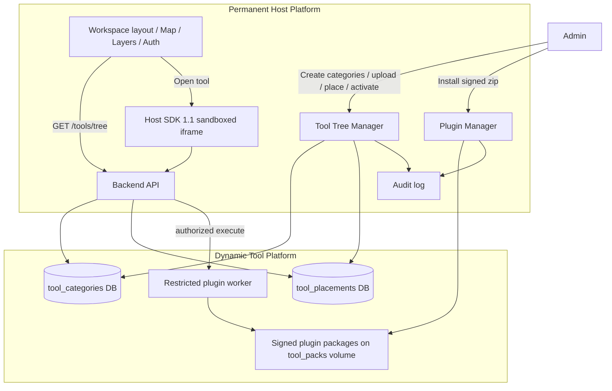

# SATEYE Plugin-First Architecture

## Layers

| Layer | Contains | Does not contain |
|-------|----------|------------------|
| **Host Platform** | Map, imagery, layers, auth, workspace, Plugin Manager, Tool Tree, Host SDK, security | Hardcoded analytical tool menus |
| **Dynamic Tool Platform** | Categories, placements, signed plugins, worker execution | Host React internals / tokens / Leaflet |

## Navigation vs execution

- **Navigation location:** category tree path (`tool_placements.category_id`)
- **Execution location:** UI slot (`tool_placements.execution_slot`)  
  Independent; change either without reinstalling.

## Empty install

`GET /api/v1/tools/tree` with no active placements returns:

> No tools installed. Create a category or upload your first tool.

Legacy 148-tool catalog remains in source (`frontend/src/toolbox/catalog.ts`, `tools/manifest.json`) but is **not** rendered.
